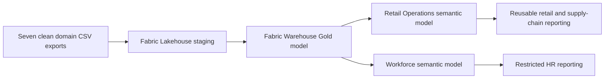

# BharatMart — Enterprise Retail Dimensional Data Model

BharatMart is a Microsoft Fabric data-modelling project for a fictional Indian retail company. The project converts seven business exports into a governed dimensional model for Sales, Returns, Promotions, Procurement, Shipments, Inventory, Order Fulfilment, Payroll, and Attendance.

The main purpose of this project is to demonstrate **dimensional modelling**, not dashboard design or data cleaning. The source data is synthetic, already clean, and created only for learning and portfolio use.

## Project at a glance

| Area | Implementation |
|---|---|
| Platform | Microsoft Fabric |
| Storage | Lakehouse staging + Fabric Warehouse |
| Warehouse model | 13 Dimensions, 9 Facts, 1 Product–Supplier Bridge |
| Retail semantic model | 20 tables, 32 measures, 52 relationships |
| Workforce semantic model | 6 tables, 6 measures, 8 relationships |
| Semantic storage mode | Direct Lake |
| Source control | Fabric Git integration with GitHub |
| Source data | Seven synthetic domain CSV exports |

## Architecture



The Warehouse is the physical enterprise data layer. The semantic models are curated business views over the same Warehouse data. Creating two semantic models does not duplicate the Warehouse tables.

## Why two semantic models?

### Retail Operations

The Retail model contains seven related business processes:

- Sales
- Returns
- Promotion Coverage
- Purchase Orders
- Shipment Lines
- Inventory Snapshot
- Order Fulfilment

These processes share conformed Dimensions such as Date, Product, Store, Customer, Supplier, Warehouse, Employee, Carrier, and Geography.

### Workforce

The Workforce model contains:

- Payroll
- Attendance
- Date
- Employee
- Department
- Store

Payroll and Attendance are kept separate from the Retail model because HR information has a different audience and security requirement.

## Warehouse schemas

| Schema | Purpose |
|---|---|
| `conformed` | Shared business Dimensions |
| `sales` | Sales and Returns Facts |
| `operations` | Inventory, Fulfilment, and Promotion Coverage Facts |
| `supply` | Purchase Orders, Shipments, and Product–Supplier Bridge |
| `workforce` | Payroll and Attendance Facts |

## Dimension tables

```text
conformed.dim_date
conformed.dim_customer
conformed.dim_product
conformed.dim_store
conformed.dim_employee
conformed.dim_department
conformed.dim_geography
conformed.dim_supplier
conformed.dim_warehouse
conformed.dim_carrier
conformed.dim_promotion
conformed.dim_payment
conformed.dim_return_reason
```

Customer, Product, and Employee include historical version columns so Facts can retain the correct business context when attributes change.

## Fact grains

Declaring the grain before creating a Fact table prevents mixed-grain data and incorrect totals.

| Fact | Declared grain |
|---|---|
| `sales.fact_sales` | One order line |
| `sales.fact_returns` | One return line |
| `operations.fact_promotion_coverage` | One date × promotion × product × store combination |
| `supply.fact_purchase_orders` | One purchase-order line |
| `supply.fact_shipment` | One shipment line |
| `operations.fact_inventory_snapshot` | One date × product × warehouse snapshot |
| `operations.fact_order_fulfillment` | One customer order |
| `workforce.fact_payroll` | One employee × pay period |
| `workforce.fact_attendance` | One employee × attendance date |

## Relationship design

The semantic models follow these rules:

```text
Dimension key 1 → * Fact foreign key
Single-direction filtering
No Fact-to-Fact relationships
One active primary Date relationship per Fact
Secondary Date roles remain inactive
```

Examples of inactive Date roles include Ship Date, Promised Date, Delivery Date, Expected Date, Received Date, Payment Date, Packed Date, and Cancelled Date. Measures use `USERELATIONSHIP` only when analysis by a secondary Date role is required.

The Retail model has:

```text
42 active relationships
10 inactive secondary-Date relationships
52 total relationships
```

The Workforce model has eight active, single-direction relationships.

## Product–Supplier Bridge

`supply.bridge_product_supplier` represents the valid association between Products and Suppliers. It also stores:

- Primary-supplier flag
- Allocation percentage

The Bridge is not connected directly to transaction Facts. Purchase Orders and Shipments contain their own Product and Supplier foreign keys at their declared grains.

## Measures

The Retail semantic model contains 32 focused measures, including:

- `Total revenue`
- `Gross Margin` and `Gross Margin %`
- `Order Count` and `AOV`
- `Promoted Revenue`
- `Total Refund` and `Period Return Unit Rate %`
- `Closing Stock` and `Inventory Value`
- `Supplier Fill Rate %`
- `On-Time Delivery %`
- `Cancellation Rate %`
- `Promotion Eligibility Rate %`

The Workforce semantic model contains six focused measures:

- Gross Payroll
- Net Payroll
- Average Net Pay per Employee
- Worked Hours
- Attendance Utilization %
- Overtime Rate %

The project intentionally uses a small set of meaningful measures instead of creating many repetitive calculations.

## Source-to-model flow

```text
1. Generate seven clean source exports.
2. Load the exports into Fabric Lakehouse staging tables.
3. Create shared Dimensions in the Warehouse.
4. Create Facts only after declaring their grains.
5. Resolve source natural IDs to Warehouse surrogate keys.
6. Validate grain uniqueness and Dimension-key coverage.
7. Build the Retail Direct Lake semantic model.
8. Build the restricted Workforce Direct Lake semantic model.
9. Add relationships, Date roles, measures, and descriptions.
10. Commit Fabric item definitions to GitHub.
```

## Repository structure

```text
Datamart_project/
├── README.md
├── docs/
│   ├── PROJECT_WALKTHROUGH.md
│   ├── MODEL_REFERENCE.md
│   ├── KPI_CATALOG.md
│   └── VALIDATION_GUIDE.md
├── source/
│   ├── BUS_MATRIX_9x13.csv
│   ├── generate_bharatmart_sources.py
│   └── README.md
├── lh_bharatmart_stage.Lakehouse/
├── wh_bharatmart.Warehouse/
├── sm_bharatmart.SemanticModel/
└── sm_bharatmart_workforce.SemanticModel/
```

## Documentation

- [Project walkthrough](docs/PROJECT_WALKTHROUGH.md)
- [Model reference](docs/MODEL_REFERENCE.md)
- [Exact KPI catalog](docs/KPI_CATALOG.md)
- [Validation guide](docs/VALIDATION_GUIDE.md)
- [Source-data note](source/README.md)

## Validation approach

The validation guide explains what should be checked when writing business-specific SQL:

- Dimension-key uniqueness
- Fact-grain uniqueness
- Orphan foreign keys
- Date-range and financial reconciliation
- Inventory balance logic
- Purchase-order receipt limits
- Shipment delivery logic
- Fulfilment status consistency

SQL queries are intentionally not included. They can be written separately for the exact business questions being analysed.

## Key design decisions

1. **Facts remain separate when their grains are different.** Sales, Returns, Inventory, Shipments, and Fulfilment are not merged into one wide table.
2. **Dimensions are conformed.** Shared Date, Product, Store, Employee, and Geography meanings remain consistent across relevant Facts.
3. **The enterprise Warehouse remains unified.** Retail and Workforce tables stay physically available in one governed Warehouse.
4. **Semantic models follow audience boundaries.** Retail and HR users receive different curated models over the same Warehouse.
5. **Relationships are intentionally approved.** Matching column names alone are not a reason to create a relationship.
6. **Direct Lake is used for the serving layer.** The semantic models query Fabric-managed Warehouse data without a separate full Import copy.

## How I explain this project

> I built a Microsoft Fabric dimensional model for a fictional retail company. I started with a business-process bus matrix and declared the grain of each Fact before creating tables. The final Warehouse contains 13 conformed Dimensions, nine Facts, and one Product–Supplier Bridge. I created a multi-Fact Retail semantic model and a separate Workforce semantic model for HR-sensitive data. Both models use Direct Lake over the same Warehouse. I configured one-to-many, single-direction relationships, active and inactive Date roles, reusable DAX measures, and Git source control. I documented the validation approach for grains, keys, and business rules.

## Data note

All data is synthetic and generated for development-scale testing. It contains no real customer, employee, supplier, or company information.
